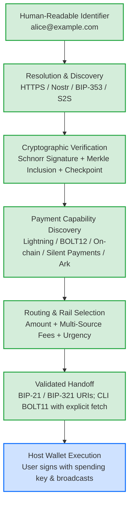
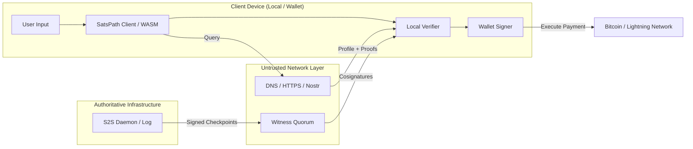

# SatsPath Architecture

SatsPath is an open-source payment discovery and routing layer for the Bitcoin ecosystem. It resolves human-readable identifiers to cryptographically authenticated payment capabilities across multiple compatible payment rails, while delegating transaction signing and execution to sovereign user wallets.

> The diagrams describe the architectural composition, not a claim that every
> rail or witness path is integrated in every interface. See the
> [current capability matrix](README.md). Daemon and router emit verified
> on-chain, Silent Payment (`sp=`), and address-backed Ark (`ark=`) BIP-21/BIP-321
> URIs; CLI BOLT11 fetching is explicit; `PaymentIntent` execution is gated to
> standard on-chain and BOLT11; daemon BOLT12 receive, WASM parity, and witness
> federation have integration gaps.

---

## 1. Core Architecture & Pipeline



### The Core Architectural Principle: Non-Custodial Separation

**SatsPath does not need, and never requests, the user's private spending keys.**

This is not a missing feature—it is an intentional **security property**:
* **No custody of funds:** SatsPath does not custody, seize, or freeze user funds.
* **No user spending secrets in discovery:** Public profiles and the daemon API must not receive wallet seeds or xprv/tprv keys. Local identity keys are separate and can be persisted by CLI/daemon. Seed-based identity derivation belongs inside the trusted host-wallet boundary. The opt-in regtest anchor feature uses operator Core RPC credentials, not user spending keys; see [mainnet safety](mainnet_safety.md).
* **Not a wallet:** SatsPath discovers and validates payment capabilities; host wallets retain 100% control over fund authorization, coin selection, transaction signing, and network broadcast.
* **Custody Risk vs. Payment Redirection Risk:** Compromising SatsPath does not directly expose wallet spending keys or authorize Bitcoin transactions. However, a compromised discovery or handoff component may attempt payment redirection, which is why authenticated profiles, key continuity, resolver verification, and wallet-side confirmation of destination details remain security-critical.

---

## 2. Workspace Crate Architecture

The SatsPath codebase is organized as a modular Rust workspace:

```text
satspath/
├── crates/
│   ├── satspath-core/          # Protocol models, secp256k1 crypto, canonical serialization,
│   │                           # Merkle tree transparency, 256-bit Sparse Merkle state map,
│   │                           # Catena Bitcoin OP_RETURN anchor chain, gossip, and resolvers
│   ├── satspath-handoff/       # Strict BIP-21/BOLT11 payload validation
│   ├── satspath-router/        # Payment capability discovery, multi-source fee consensus,
│   │                           # BOLT12 handling, BIP-352 Silent Payments, routing heuristics, and handoff
│   ├── satspath-cli/           # Reference command-line client for development and preview flows
│   ├── satspathd/              # Modular authoritative daemon:
│   │   └── src/
│   │       ├── handlers/       #   claim, profile, quote, resolve, send, status, transparency, wallet
│   │       ├── telemetry/      #   Metrics, /v1/health dependency probes, structured tracing
│   │       ├── rate_limit.rs   #   Per-IP token-bucket rate limiter & 64 KB payload guard
│   │       ├── server.rs       #   HTTP/TLS lifecycle & cleartext binding security audit
│   │       └── v2_api.rs       #   S2S v2 authoritative resolution & witness proof envelopes
│   ├── satspath-witness/       # Witness/cosigning library; src/bin/satspath-gossip.rs monitor
│   ├── satspath-conformance/   # Incremental conformance runner and vectors
│   ├── satspath-wasm/          # WebAssembly bindings for browser and web wallet integrations
│   ├── satspath-swaps/         # Experimental testnet/regtest swap scaffolding (submarine/reverse)
│   └── satspath-pqc/           # Experimental post-quantum hybrid signature research module (ML-DSA-65)
├── sdk/satspath-p2p/           # Optional Node.js Hyperswarm P2P profile transport
└── proxy-workers/bolt12/       # Experimental BOLT12 HTTP worker scaffold (dummy invoice; backend TODO)
```

### Crate Responsibilities & Maturity

| Crate | Maturity Status | Role & Safety Boundary |
| :--- | :--- | :--- |
| **`satspath-core`** | **IMPLEMENTED** | Core protocol primitives: profile schemas, canonical RFC 8785 JSON, `secp256k1` Schnorr signatures, append-only Merkle log, Sparse Merkle state map, and resolver chain. |
| **`satspath-handoff`** | **IMPLEMENTED** | Shared strict payload checks for network, exact amount, addresses and BOLT11. |
| **`satspath-router`** | **IMPLEMENTED** | Evaluates payment methods, aggregates multi-source fee estimates, formats wallet handoffs, and contains experimental BOLT12 and BIP-352 handling primitives subject to the capability-specific maturity limits documented in README.md. |
| **`satspath-cli`** | **IMPLEMENTED** | Developer tool for local profile generation, proof verification, route simulation, and QR generation. Does not execute mainnet payments. |
| **`satspathd`** | **IMPLEMENTED** | Server-to-server daemon exposing authenticated profile endpoints, transparency logs, signed checkpoints, and rate-limiting defenses. |
| **`satspath-witness`**| **COMPONENTS IMPLEMENTED** | Cosigning/verification library plus gossip monitor binary. Not a complete daemon-integrated witness service or deployed federation. |
| **`satspath-conformance`** | **INCREMENTAL** | Runner/vectors with [explicit coverage limits](../crates/satspath-conformance/README.md). |
| **`satspath-wasm`** | **PREVIEW** | Separate browser implementation, not a build of the native core; local/Nostr resolution and native parity remain incomplete. |
| **`satspath-swaps`** | **EXPERIMENTAL**| Testnet/regtest scaffolding for Boltz v2 swaps. Encrypted local store (AES-256-GCM) and claim/refund tx builders for testnet only. |
| **`satspath-pqc`** | **RESEARCH** | Research prototype testing hybrid classical + post-quantum signatures (`secp256k1` + ML-DSA-65). Not part of the production safety claim. |

---

## 3. Data Flow & Security Boundaries



### Trust Boundaries

1. **Identity Keypair:** Authorizes profiles and identity transitions, not spending. CLI persists local identity keys; the daemon's local-wallet mode also generates/stores an identity key in its home. Do not claim that every deployment keeps all identity keys off-server. Private identity keys must not enter public profiles or handoffs.
2. **Resolver Transports:** HTTPS, Nostr, DNS, and local files are treated as untrusted transports. All returned profiles must be independently verified by the local client.
3. **Log Operator:** The log operator signs checkpoints committing to append-only history. It cannot author identity changes or key rotations without the user's private key signature.
4. **Witness Quorum & Catena Anchoring:** The witness library implements checkpoint cosigning/verification. The current daemon serves empty `witness_cosignatures` and does not verify quorum; the diagram's cosignature path is a target integration, not live federation evidence. Catena primitives and the operator-only regtest anchor path are separate. See [S2S server status](s2s/server-v2.md) and [mainnet safety](mainnet_safety.md).
5. **Host Wallet:** The host wallet remains the sovereign arbiter of funds. SatsPath provides the validated payment instructions; the wallet checks amounts, prompts the user, signs, and broadcasts.
